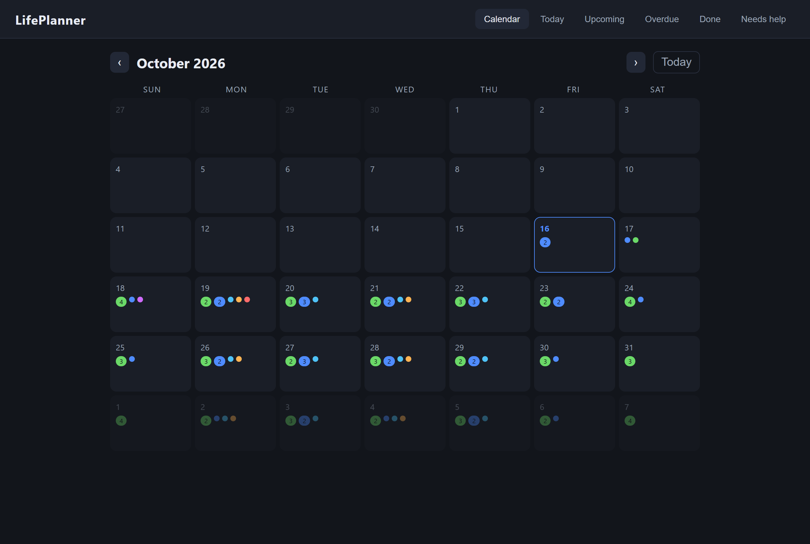
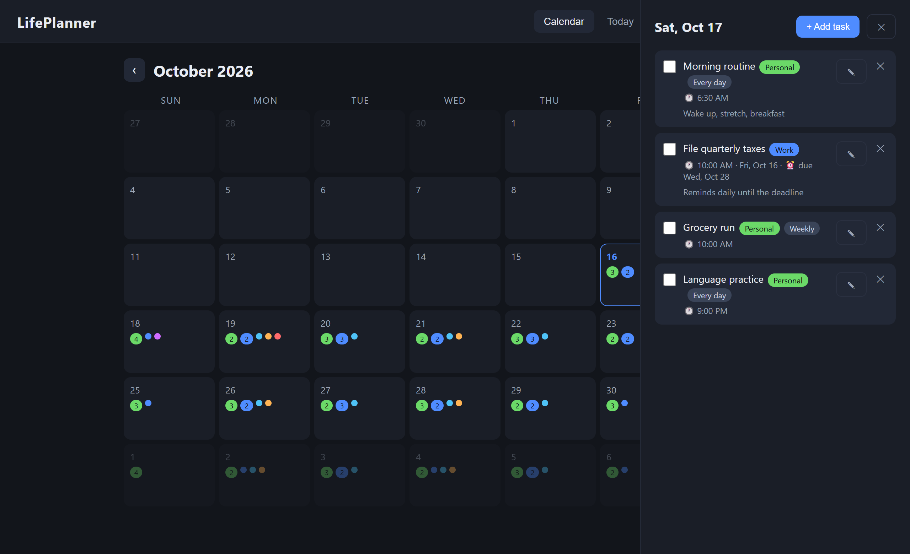

# LifePlanner

A local-first daily planner that lives in a folder: a zero-dependency Node
server, one HTML page, and Windows toast reminders. No account, no database,
no `npm install` — the only state is a JSON file next to the app.



## Why it exists

I wanted a planner that tells me *when* something is due without shipping my
schedule to someone else's server, and without a build step I have to maintain.
So: plain Node's `http` module, a JSON file, and the Windows notification API
through PowerShell. It starts silently with the machine and stays out of the way
until a task is due.

## Features

- **Month calendar** with per-day counts by task type; click any day to open its panel
- **Five views** — Calendar, Today, Upcoming, Overdue, Done, plus *Needs help*
- **Recurrence** — once, every day, every other day, or weekly on chosen days
- **Deadlines** — an optional due date makes the task remind you *daily* until it passes
- **Windows toasts** at the task's time, with a 15-minute grace window so a missed
  second doesn't silence the reminder
- **6 AM digest** listing the first four tasks of the day
- **Task types with colors** — class, homework, work, personal, spontaneous, appointment
- **"Need help with this"** flag for tasks you intend to hand to someone else
- **Autostart** — silent at login (`startup.vbs`), window on demand (`start.vbs`)
- **Optional desktop window** via `desktop.py` (pywebview), if you prefer an app frame



## How it works

```
server.js        http server: REST for tasks, static files, the reminder loop
public/          index.html + app.js + styles.css (no framework, no bundler)
notify.ps1       posts a Windows toast through the WinRT toast API
autostart.js     starts the server only if the port is not already answering
seed-demo.js     posts a demo week so a fresh install is not empty
start.bat        run in a console (Ctrl+C to stop)
start.vbs        start hidden, then open the browser
startup.vbs      silent start, for the Windows Startup folder
stop.bat         kills whatever holds the port
desktop.py       optional pywebview window wrapper
```

State lives in `../data/tasks.json` (next to the app folder, so the code and the
data stay separate). Notification de-duplication lives in
`../data/notified.json` and self-trims after seven days.

Two environment variables make it easy to run more than one copy:

| Variable | Default | Purpose |
| --- | --- | --- |
| `PORT` | `3141` | Port the server listens on |
| `LIFEPLANNER_DATA` | `../data` | Where `tasks.json` and `notified.json` live |

## Run it

Requires Node 18+.

```bash
node server.js          # http://localhost:3141
node seed-demo.js       # optional: fills it with a demo week
```

Reminders are checked every 30 seconds while the server runs.

**Start with Windows** (optional): press `Win+R`, run `shell:startup`, and put a
shortcut to `startup.vbs` in that folder. It starts the server without a window.
Use `start.vbs` when you actually want the planner open.

**As a desktop window** (optional): `pip install pywebview`, then
`python desktop.py`. Closing the window leaves the server running so reminders
keep firing; `stop.bat` shuts it down.

## Platform notes

The app is plain Node and works anywhere, but the *reminders* go through
`notify.ps1`, which uses the Windows toast API (WinRT). On macOS or Linux the
planner still runs and still tracks everything — you would swap the one call in
`fireToast()` for `osascript` or `notify-send`.

## Portfolio edition

This repository is published as a reference copy of a tool I use daily. Two
things differ from my personal install: launcher paths are relative instead of
absolute, and the sample data is a demo week rather than a real schedule. The
task, recurrence, deadline, and notification logic is unchanged.

## License

Published for reference only — all rights reserved. See [LICENSE](LICENSE).

---

Built by **Argelo Cumayas Nuñez** · [argelo.spawntel.com](https://argelo.spawntel.com) · [github.com/Arvoszn](https://github.com/Arvoszn)
